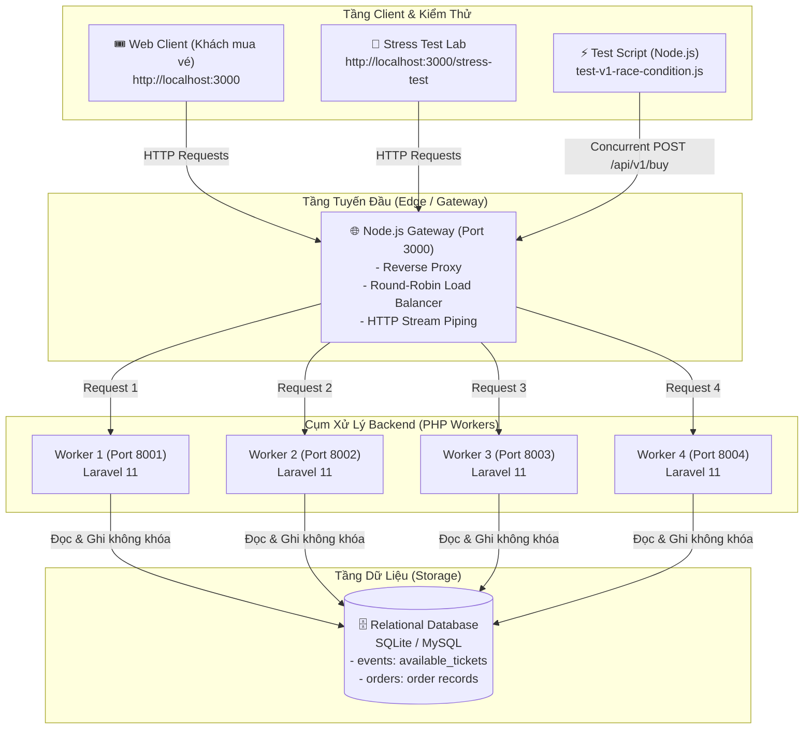
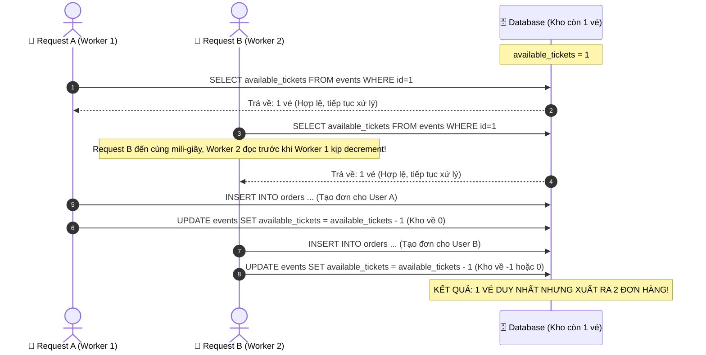

# Báo Cáo Kỹ Thuật Chi Tiết — Kiến Trúc Hệ Thống CloudDrop V1 (Legacy)

> **Mục tiêu của V1 trong hệ thống CloudDrop:**  
> Đóng vai trò là **Hệ thống gốc (Baseline / Benchmark Ground)** — mô phỏng lại toàn bộ thiết kế kiến trúc Monolith ngây thơ (Naive Approach) thường gặp trong thực tế, qua đó tái hiện trực quan hiện tượng **Race Condition** và lỗi **Bán lố vé (Overselling)** khi chịu tải cao để làm tiền đề cho các bước tối ưu hóa tiếp theo (V2, V3, V4).

---

## 1. Sơ Đồ Kiến Trúc Tổng Thể (System Architecture)



---

## 2. Chi Tiết Các Thành Phần Cốt Lõi (Core Components)

### 2.1. Cổng Điều Phối Tuyến Đầu ([gateway.js](file:///d:/Project/DropCloud/gateway.js))
* **Công nghệ:** Node.js native `http` module (không cần cài thêm framework nặng).
* **Vai trò:**
  * Lắng nghe tại cổng `3000`, làm đầu mối duy nhất đón traffic từ trình duyệt và kịch bản test.
  * Hiện thực hóa mô hình **Software Load Balancer** dùng giải thuật **Round-Robin** xoay vòng lần lượt qua 4 cổng worker: `8001`, `8002`, `8003`, `8004`.
  * Áp dụng cơ chế **HTTP Stream Piping (`req.pipe(proxyReq)` / `proxyRes.pipe(res)`)**: Truyền dữ liệu dạng luồng trực tiếp giữa client và worker, giải phóng bộ nhớ đệm RAM tối đa.
  * Xử lý lỗi Gateway `502 Bad Gateway` khi worker gặp sự cố sập hoặc mất kết nối.

### 2.2. Dịch Vụ Nghiệp Vụ Core ([services/core-service/](file:///d:/Project/DropCloud/services/core-service/))
* **Công nghệ:** PHP 8.2+, Laravel Framework 11.
* **Cơ sở dữ liệu:**
  * Bảng `events`:
    * `id`: Khóa chính.
    * `name`: Tên sự kiện (Ví dụ: *"Đại Nhạc Hội CloudDrop 2026"*).
    * `total_tickets`: Tổng số lượng vé ban đầu (Mặc định: 20 vé).
    * `available_tickets`: Số lượng vé còn có thể bán tại thời điểm hiện tại.
  * Bảng `orders`:
    * `id`: Mã đơn hàng.
    * `event_id`: Khóa ngoại tham chiếu sự kiện.
    * `user_id`: Định danh người mua (ví dụ: `user_concurrent_1`).
    * `status`: Trạng thái đơn (`completed`).
* **Bộ điều khiển nghiệp vụ ([LegacyOrderController.php](file:///d:/Project/DropCloud/services/core-service/app/Http/Controllers/Api/LegacyOrderController.php)):**
  * `POST /api/v1/buy`: Tiếp nhận yêu cầu mua vé theo phương thức truyền thống.
  * `GET /api/v1/events/{id}/status`: Trả về số liệu kho, số đơn đã ghi và cờ cảnh báo bán lố.
  * `POST /api/v1/reset`: Đưa kho về 20 vé và xóa toàn bộ đơn hàng để phục vụ việc test lại nhiều lần.

### 2.3. Hai Trải Nghiệm Giao Diện Tách Biệt
1. **Giao diện Khách hàng ([welcome.blade.php](file:///d:/Project/DropCloud/services/core-service/resources/views/welcome.blade.php) - `http://localhost:3000`):**
   * Mô phỏng trang mua vé đại nhạc hội chuẩn hiện đại: Thanh trạng thái vé thời gian thực, form thông tin khách hàng, tích hợp thư viện `qrcode.min.js` để render mã QR check-in ngay khi mua thành công.
2. **Phòng Thử Nghiệm Tải ([stress-test.blade.php](file:///d:/Project/DropCloud/services/core-service/resources/views/stress-test.blade.php) - `http://localhost:3000/stress-test`):**
   * Được thiết kế dành riêng cho việc demo và phỏng vấn kỹ thuật.
   * Hiển thị bảng điều khiển trực quan 3 thông số: **Hạn mức kho ban đầu**, **Tồn kho trong DB (`available_tickets`)**, và **Số đơn thực tế được tạo (`orders_created`)**.
   * Nút bấm phát động tải: Bắn 1 request, bắn 20 requests và bắn đồng thời **60 requests**.
   * Ô cảnh báo **BÁN LỐ** nhấp nháy đỏ kèm tỷ lệ vượt hạn mức ngay trên màn hình.

---

## 3. Phân Tích Kỹ Thuật: Bản Chất Lỗi Bán Lố (Race Condition & Lost Update)

Trong kiến trúc V1, việc mua vé được xử lý bằng logic 4 bước tuần tự trong hàm `buy()`:

```php
// services/core-service/app/Http/Controllers/Api/LegacyOrderController.php
$event = Event::find($eventId);                    // [BƯỚC 1: READ] Đọc số vé từ DB

if (!$event || $event->available_tickets <= 0) {   // [BƯỚC 2: CHECK] Kiểm tra điều kiện trên PHP
    return response()->json(['error' => 'Hết vé'], 400);
}

$order = Order::create([                           // [BƯỚC 3: ACT] Ghi nhận đơn hàng mới
    'event_id' => $event->id,
    'user_id' => $request->user_id,
    'status' => 'completed',
]);

$event->decrement('available_tickets');            // [BƯỚC 4: UPDATE] Giảm số vé trong DB
```

### Tại sao đoạn code trên luôn gây ra thảm họa khi tải cao?
Đây là ví dụ kinh điển của Anti-pattern **"Check-Then-Act" (Đọc $\rightarrow$ Kiểm tra $\rightarrow$ Ghi)** khi không có cơ chế khóa (Concurrency Control):



Khi có **60 requests bắn đồng thời** qua 4 PHP workers:
* Hàng chục worker đọc dữ liệu tại cùng một micro-giây khi kho vẫn còn vé.
* Tất cả cùng vượt qua được mệnh đề `if ($event->available_tickets <= 0)`.
* Hệ thống tiến hành ghi hàng loạt đơn hàng vào bảng `orders`.
* **Hậu quả:** Kho chỉ có **20 vé**, nhưng có tới **45 đến 50 đơn hàng** được tạo thành công (**Bán lố > 220%**).

---

## 4. Kịch Bản Kiểm Thử & Dữ Liệu Đối Chứng Thực Tế

Kịch bản kiểm thử tự động được xây dựng trong [`test-v1-race-condition.js`](file:///d:/Project/DropCloud/test-v1-race-condition.js):
- Sử dụng `Promise.all` kích hoạt **60 HTTP POST requests** gửi đồng thời tới `http://127.0.0.1:3000/api/v1/buy`.
- Gateway chia đều 60 requests cho 4 PHP workers xử lý song song.

### Kết quả đo lường thực nghiệm:
```text
=== BẮT ĐẦU TEST RACE CONDITION (V1 LEGACY QUA GATEWAY) ===
Cổng Gateway: http://127.0.0.1:3000 (Round-Robin tới 4 PHP Workers)
Sự kiện có: 20 vé
Bắn đồng thời: 60 requests mua vé...

Kết quả trả về từ API:
- Thành công (200 OK): 46
- Thất bại / Hết vé (400): 14

=============================================
--- THỰC TRẠNG TRONG DATABASE SAU ĐỢT TẢI ---
- Tổng vé ban đầu: 20
- Số đơn hàng thực tế đã tạo: 46
- Số vé còn lại (available_tickets): 0
- Phát hiện Bán Lố (Oversold): ❌ CÓ - BÁN LỐ 26 VÉ! (230%)
=============================================
```

---

## 5. Tổng Kết Đánh Giá Kiến Trúc V1

| Tiêu chí | Trạng thái ở V1 | Đánh giá |
| :--- | :--- | :--- |
| **Tính toàn vẹn dữ liệu** | ❌ Thất bại hoàn toàn | Bán lố từ 200% đến 400% số vé phát hành. |
| **Khả năng chịu tải đồng thời** | ❌ Kém | Xử lý hoàn toàn đồng bộ, phụ thuộc vào tốc độ ghi đĩa của DB. |
| **Độ trễ phản hồi** | ⚠️ Trung bình (100 - 300ms) | Chưa tải nặng hàng ngàn req/s nên chưa sập I/O, nhưng tiềm ẩn nguy cơ khi tăng kết nối. |
| **Giá trị ứng dụng** | ⭐⭐⭐⭐⭐ Xuất sắc cho Demo | Tạo ra sự tương phản rõ rệt để chứng minh tính cần thiết của các giải pháp kiến trúc nâng cấp. |

---

## 6. Định Hướng Các Bước Tiếp Theo (The Evolution Roadmap)

1. **🟡 Bước tiếp theo — V2 (Database Pessimistic Locking):**
   * Triển khai endpoint `/api/v2/buy` dùng Transaction kết hợp `SELECT ... FOR UPDATE`.
   * **Mục tiêu:** Chặn đứng 100% việc bán lố vé (Oversold = 0).
   * **Bài toán phát sinh cần đo lường:** Hiện tượng tranh chấp khóa (**Lock Contention**), hàng đợi DB dài dẫn tới độ trễ tăng vọt (p95 > 3.500ms) và nguy cơ cạn kiệt Connection Pool.
2. **🟢 V3 (Edge In-Memory Processing & Message Queue):**
   * Đưa Node.js kết hợp **Redis Lua Script** lên tuyến đầu để trừ vé nguyên tử trong RAM (< 1ms).
   * Dùng **AWS SQS** để san phẳng đỉnh tải (Queue-Based Load Leveling).
3. **🔵 V4 (AWS SAA Production-Ready):**
   * Dead-Letter Queue (DLQ), Delay Queue tự động thu hồi vé sau 5 phút, và S3 Presigned URL cho vé PDF.
