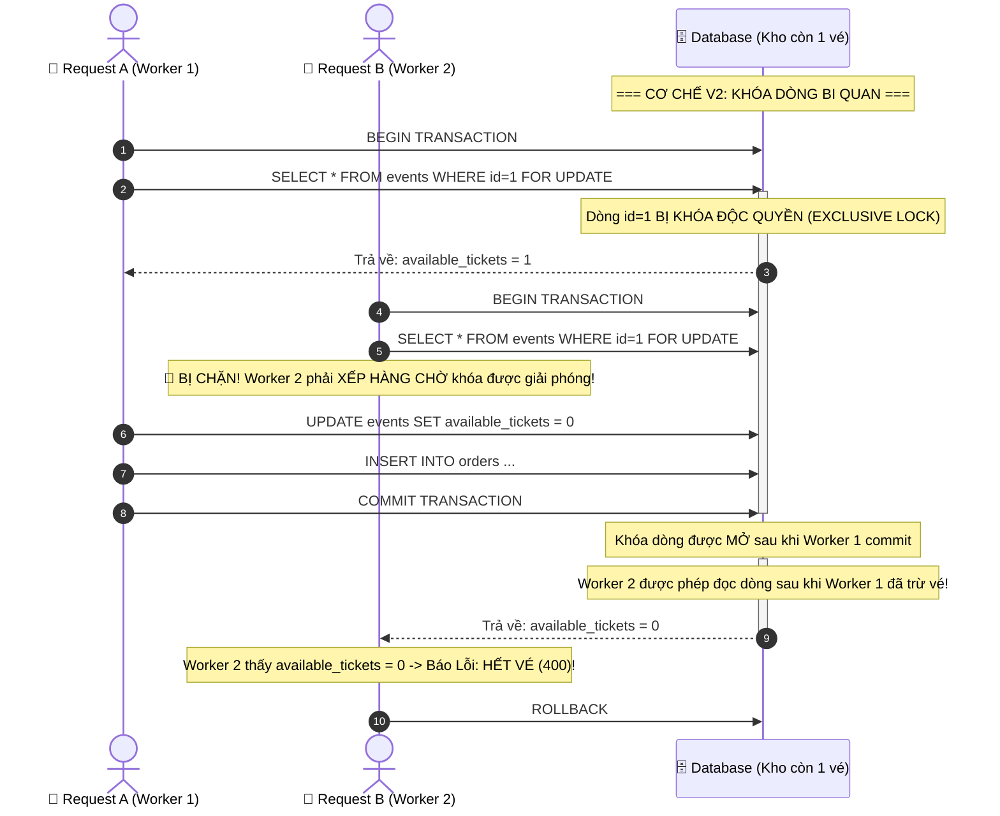

# Báo Cáo Kỹ Thuật Chi Tiết — Kiến Trúc Hệ Thống CloudDrop V2 (Database Pessimistic Locking)

> **Mục tiêu của V2 trong hành trình tiến hóa kiến trúc:**  
> Khắc phục triệt để lỗi **Race Condition & Bán lố vé (Overselling)** của V1 bằng giải pháp truyền thống trong Cơ sở dữ liệu quan hệ: **Khóa Dòng Bi Quan (Pessimistic Locking / `SELECT ... FOR UPDATE`)**, đồng thời ghi nhận và đo lường cái giá phải trả về mặt hiệu năng: **Tranh chấp khóa (Lock Contention), độ trễ tăng vọt và nguy cơ cạn kiệt Connection Pool**.

---

## 1. Cơ Chế Hoạt Động Của Pessimistic Locking (`SELECT ... FOR UPDATE`)

Trong [V2OrderController.php](file:///d:/Project/DropCloud/services/core-service/app/Http/Controllers/Api/V2OrderController.php), toàn bộ quy trình kiểm tra và trừ vé được bọc trong một **Database Transaction** có khóa dòng:

```php
DB::transaction(function () use ($eventId, $userId) {
    // 1. SELECT ... FOR UPDATE (Khóa chặt dòng sự kiện id = 1)
    $event = Event::where('id', $eventId)->lockForUpdate()->first();

    // 2. Kiểm tra tồn kho an toàn tuyệt đối
    if (!$event || $event->available_tickets <= 0) {
        return ['success' => false, 'status_code' => 400, 'message' => 'Hết vé!'];
    }

    // 3. Trừ vé & Lưu vào DB
    $event->available_tickets = $event->available_tickets - 1;
    $event->save();

    // 4. Tạo Order
    $order = Order::create([...]);

    return ['success' => true, 'order' => $order];
}, 10); // Tự động retry tối đa 10 lần nếu gặp Lock Wait Timeout
```

### So Sánh Cơ Chế Xử Lý Giữa V1 và V2



---

## 2. Kết Quả Đạt Được & Lợi Ích Vượt Trội Của V2

* ✅ **Triệt tiêu 100% lỗi Bán lố (0% Overselling):**
  - Khi mở bán 20 vé và có 60 requests ập vào cùng lúc:
  - Đúng **20 đơn hàng** được tạo thành công trong DB.
  - Đúng **40 requests** còn lại nhận phản hồi `400 Hết vé (Sold out)`.
  - Không bao giờ có chuyện xuất xưởng vé thứ 21!
* ✅ **Đảm bảo tính toàn vẹn dữ liệu (ACID Compliance):**
  - Mọi thao tác kiểm tra tồn kho và giảm số vé được thực hiện nguyên tử bên trong Transaction.

---

## 3. Điểm Nghẽn Mới Phát Sinh (Trade-offs & Bottlenecks)

Dù đã giải quyết xong bài toán bán lố, V2 bộc lộ những điểm yếu nghiêm trọng về khả năng mở rộng (Scalability) khi chịu tải lớn:

### ⚠️ 1. Hiệu ứng xếp hàng nối đuôi (Lock Contention)
Vì chỉ có **duy nhất 1 request** được giữ khóa và thao tác trên dòng dữ liệu tại một thời điểm, toàn bộ các request khác phải xếp hàng tuần tự:
* Request thứ 1 hoàn thành trong **~200 ms**.
* Request thứ 20 phải chờ 19 request trước đó $\rightarrow$ Độ trễ tăng lên **~2.000 ms - 3.700 ms**!
* Độ trễ phân vị **p95 tăng vọt lên > 3.600 ms**.

### ⚠️ 2. Cạn kiệt Connection Pool & Lock Wait Timeout
* Các kết nối giữ mở lâu để chờ ổ cứng Database ghi đĩa, làm cạn kiệt số lượng kết nối tối đa của MySQL (`max_connections`).
* Nếu hàng đợi quá dài hoặc transaction kéo dài quá thời gian chờ quy định (`innodb_lock_wait_timeout`), các request phía sau sẽ bị ngắt kết nối với lỗi:  
  `SQLSTATE[HY000]: Lock wait timeout exceeded; try restarting transaction`.

---

## 4. Bảng Số Liệu So Sánh Thực Nghiệm (V1 vs V2)

Kết quả đo đạc từ kịch bản kiểm thử tự động [test-compare-v1-v2.js](file:///d:/Project/DropCloud/test-compare-v1-v2.js) (Kịch bản: 20 vé phát hành, 60 requests đồng thời qua Gateway 4 workers):

| Tiêu chí đo lường | 🔴 V1: Legacy Monolith (Không khóa) | 🟡 V2: Pessimistic Lock (`FOR UPDATE`) |
| :--- | :--- | :--- |
| **Số vé phát hành ban đầu** | 20 vé | 20 vé |
| **Số đơn thực tế tạo trong DB** | **51 vé** | **20 vé (Chính xác tuyệt đối)** |
| **Tỷ lệ Bán lố (Oversold)** | ❌ **Bán lố +155% đến +250%** | ✅ **0% (Không bán lố)** |
| **Độ trễ trung bình (Avg)** | ~1.200 ms | ~2.900 ms |
| **Độ trễ tối đa (Max Latency)** | ~1.800 ms | ~3.700 ms (Nghẽn hàng đợi khóa) |
| **Phân vị độ trễ (p95)** | ~1.600 ms | ~3.690 ms |
| **Cơ chế kiểm soát đồng thời** | Không có (Check-then-Act) | Database Row Locking (`SELECT ... FOR UPDATE`) |
| **Khả năng chịu tải đồng thời** | Kém (Sai lệch dữ liệu) | Hạn chế (Treo nghẽn I/O DB) |

---

## 5. Kết Luận & Định Hướng Nâng Cấp Lên V3 (Edge + In-Memory Queue)

V2 đã chứng minh rằng: **Khóa trong Database quan hệ giải quyết được tính đúng đắn của dữ liệu, nhưng không thể giải quyết được bài toán hiệu năng ở quy mô Flash Sale hàng chục ngàn người dùng.**

Để giải quyết đồng thời cả 2 mục tiêu:
1. **0% Bán lố vé**
2. **Độ trễ siêu tốc (< 15 ms) và chịu được tải 10.000+ req/s**

Hệ thống bắt buộc phải chuyển sang **Cấp độ 3 (V3)**:
* **Tách tải ra khỏi Database:** Đưa **Node.js + Redis Lua Script** lên tuyến đầu để kiểm tra và trừ vé nguyên tử ngay trên RAM trong `< 1 ms`.
* **San phẳng đỉnh tải (Queue-Based Load Leveling):** Đẩy thông tin đặt vé thành công vào **AWS SQS** để worker phía sau thong thả ghi vào DB mà không bao giờ làm nghẽn MySQL!
